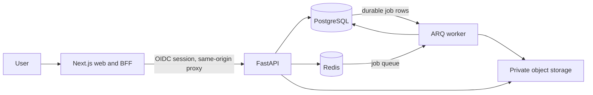

# Architecture

LabLens is a provider-neutral modular monolith with separate web, API, and worker processes. Local Compose is a development environment; production services should use managed stateful dependencies and the deployment platform's TLS, secret, monitoring, and backup facilities.

## Identity and trust boundaries

- Auth.js signs users in through a configured OIDC provider. Local credentials exist only when `APP_ENV=development` and a development token is configured.
- Auth.js stores only an opaque session identifier in its HttpOnly encrypted cookie. Access and refresh tokens are encrypted with AES-256-GCM and stored server-side in Redis. The BFF allowlists report routes, checks request origin for state-changing calls, and attaches a valid API access token.
- The API independently verifies JWT signature, issuer, audience, and expiry against the configured JWKS. Stable `(issuer, subject)` identities scope every report and result query.
- Do not use a provider configuration whose API token is opaque or whose audience is not the API audience. Configure the OIDC provider to issue a signed JWT access token for `OIDC_AUDIENCE`.

## Report processing

The API accepts bounded PDF, PNG, and JPEG files, stores them privately, and commits a report plus a durable job row. The worker dispatches job rows through Redis, validates PDF readability/encryption/page count, and moves reports to `awaiting_review`. Results are currently entered manually; only user-confirmed numeric results receive deterministic inclusive range comparison. Corrections invalidate the prior status.

The worker does **not** perform OCR, layout/table extraction, or AI explanation. Those steps require provenance, confidence/review handling, approved sources, clinical review, and evaluation before implementation. Do not infer missing units or reference bounds.

## Persistence, deletion, and operations

- PostgreSQL stores user identifiers, report metadata, result fields, jobs, and audit events. Document bytes are held in private filesystem storage locally or S3-compatible storage when configured.
- Deletion is asynchronous: the report is hidden immediately, then a worker deletes object bytes and cascades database rows. A production retention policy must also define backup expiration and deletion guarantees.
- Readiness checks require PostgreSQL and Redis. Liveness is process-only. Logs avoid report content and return request IDs for error correlation.
- Apply Alembic migrations as a controlled release step. Compose runs the initial migration before starting the API for convenience; production rollout and rollback need an explicit migration procedure.

## Production controls and open work

Use HTTPS externally, exact allowed hosts/origins, managed PostgreSQL/Redis/private object storage, encryption at rest and in transit, restricted service identities, secret-manager injection, dependency and image scanning, backups with restore drills, redacted monitoring, alerting, incident handling, and documented retention. `docs/production-readiness.md` tracks features and launch gates that remain open.
